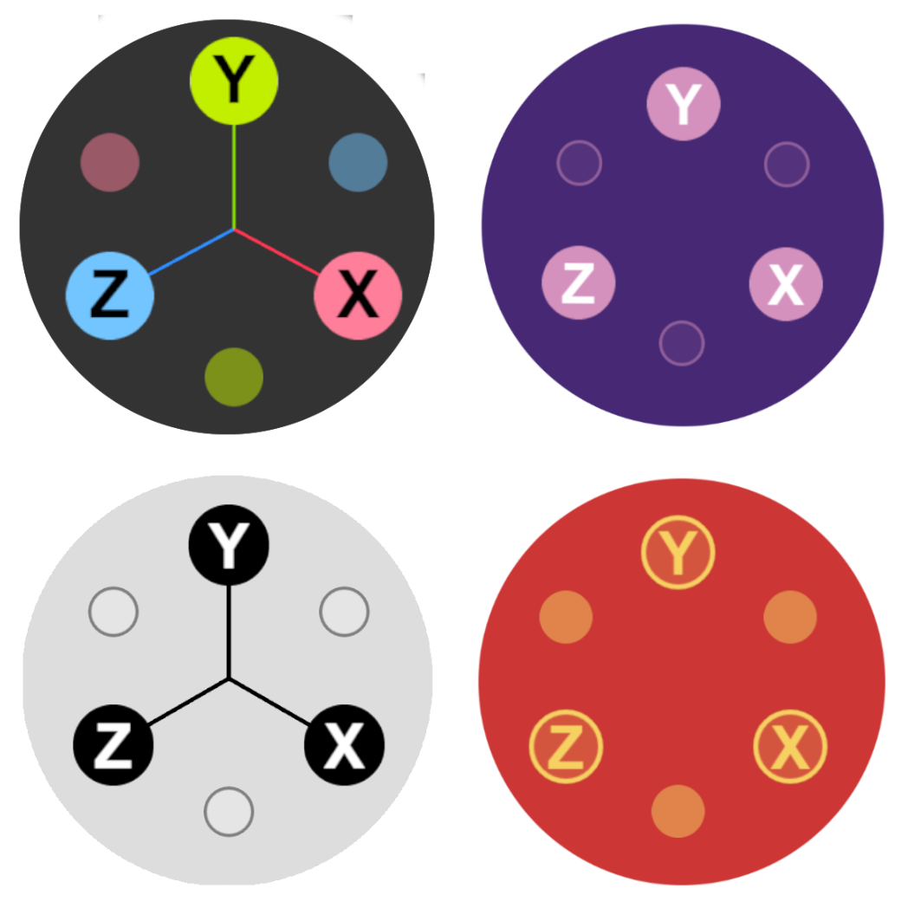

<h1 align="center">Three Viewport Gizmo</h1>

<p align="center">
  <a href="https://taucad.github.io/three-viewport-gizmo/">
  
  </a>
</p>

**Three Viewport Gizmo** is a view cube and orientation sphere for [three.js](https://threejs.org/). Click a face, edge or corner to turn the camera to it, drag it to orbit, or drive it from the keyboard. It works alone, with [OrbitControls](https://threejs.org/docs/#examples/en/controls/OrbitControls), or with [camera-controls](https://github.com/yomotsu/camera-controls), on `WebGLRenderer` and `WebGPURenderer`.

<h3 align="center">
  <a href="https://taucad.github.io/three-viewport-gizmo/">Documentation</a> -
  <a href="https://taucad.github.io/three-viewport-gizmo/docs/quickstart/">Quickstart</a> -
  <a href="https://taucad.github.io/three-viewport-gizmo/docs/migrating/">Migrating from 2.x</a> -
  <a href="https://taucad.github.io/three-viewport-gizmo/docs/api/">API</a> -
  <a href="https://taucad.github.io/three-viewport-gizmo/playground/">Playground</a> -
  <a href="https://taucad.github.io/three-viewport-gizmo/matrix/">Matrix</a>
</h3>

---

## Install

3.0 is in beta. Install it with the `beta` tag:

```sh
npm i @taulabs/three-viewport-gizmo@beta three
```

Without the tag, npm installs 2.x until 3.0 is stable. The package is ESM only and needs `three` 0.167 or later as a peer dependency (0.171 or later with `WebGPURenderer`).

## Quickstart

Put the canvas in the page, create the gizmo with your camera and renderer, attach your controls and render the gizmo after the scene every frame. `camera`, `renderer`, `scene` and `viewport` (the canvas's parent element) are your own.

```ts
import { OrbitControls } from "three/addons/controls/OrbitControls.js";
import { ViewportGizmo } from "@taulabs/three-viewport-gizmo";

// The gizmo goes into the canvas's parent, so add the canvas first.
viewport.appendChild(renderer.domElement);

const controls = new OrbitControls(camera, renderer.domElement);

const gizmo = new ViewportGizmo(camera, renderer);
gizmo.attachControls(controls);

renderer.setAnimationLoop(() => {
  renderer.render(scene, camera);
  gizmo.render();
});
```

The gizmo measures its own box when it renders, so a resize needs nothing from it. This block is the docs site's `site/samples/quickstart.ts`, which the docs build compiles; the build fails if the two differ.

## Features

- **WebGL and WebGPU.** Pass a `WebGLRenderer` or a `WebGPURenderer` (after `await renderer.init()`); see [WebGPU](https://taucad.github.io/three-viewport-gizmo/docs/webgpu/).
- **Six up axes.** Any signed axis can be up, read from `camera.up` or set with `up`, and `frontDirection` chooses where Front faces; see [Up axis](https://taucad.github.io/three-viewport-gizmo/docs/up-axis/).
- **Roll modes.** `roll: false` keeps the view upright as in 2.x, `true` lets clicks and turns roll it, and `'free'` takes the single shortest rotation (free orbit, trackball-style). The default follows the controls; see the [API reference](https://taucad.github.io/three-viewport-gizmo/docs/api/#gizmo-options).
- **Controlled mode.** With `controlled: true` the gizmo reports each pose in `change` and writes no camera, for hosts that own their camera; see [Controlled mode](https://taucad.github.io/three-viewport-gizmo/docs/controlled-mode/).
- **Keyboard.** The gizmo is a focusable `role="application"`: the arrow keys step to the neighbouring view, digits 1 to 6 look from each face, Home goes home and Shift with Left or Right rolls; see [Keyboard and accessibility](https://taucad.github.io/three-viewport-gizmo/docs/keyboard/).
- **Navigation buttons.** The opt-in `navigation` option draws side arrows, roll arrows and Home in the gizmo's element; see [Navigation](https://taucad.github.io/three-viewport-gizmo/docs/navigation/).
- **Turns from code.** `lookFrom()` and `turn()` return a promise of the outcome, and `start`, `change` and `end` say what caused each turn.

Compare renderers, up axes, gizmo types and controllers in the [Playground](https://taucad.github.io/three-viewport-gizmo/playground/) (the configuration is in the URL) and the [Matrix](https://taucad.github.io/three-viewport-gizmo/matrix/) (every up axis on both renderers at once).

## Migrating from 2.x

3.0 is a breaking release: ESM only, the canvas's parent as the default container, `EventDispatcher` instead of `Object3D`, no inline cursor or stacking styles, new event payloads and validated options. The [migration guide](https://taucad.github.io/three-viewport-gizmo/docs/migrating/) lists every change with the code that replaces it.

## Credits

Tau maintains this fork of [three-viewport-gizmo](https://github.com/Fennec-hub/three-viewport-gizmo) by Fennec. 3.0 builds on the work and reports below; the numbers are [upstream](https://github.com/Fennec-hub/three-viewport-gizmo) issues and pull requests, and the letter ids are items of the 3.0 scope.

| Contributor | Contribution |
| --- | --- |
| Fennec-hub | The library and its design; the `container` advice behind U1; `readonly target` (R10) |
| KarlSimumatik | Z-up and X-up drag (#32), the first non-Y-up support |
| felixtrz | `three` as a peer dependency (#15) |
| lleuppi | `font.size` (#40); the pole azimuth report behind U7 |
| evencewang | Controlled mode, intent events and view names (#56), the model for U4 |
| designbyadrian | Runtime enable switches and drag gating (#51, #52), the model for U10 |
| riccardo-hash | The alias and `face` mismatch (#59, R4) and the `dispose()` leak (#58) |
| TaviTav, JarSeal, WREQI | The WebGPU viewport patch (#48) and line material report (#26) |
| Brakebein | The hover event request (#38), behind `hoverchange` and R6's render signal |
| Error806 | Root-cause analysis of the Euler roll (#14) |
| meszaros-lajos-gyorgy, xaliphostes, ChrisdevManukai | `TrackballControls` (#37, #28, #46), behind U2 |
| johanohly, hihailey, sam-thomas-dd, seansackowitz | Z-up reports (#19, #29, #41), behind R12 |
| brean | Front-axis convention (#35), behind U7 and U8 |
| mdotcdotm, skelly-energid, waveflip | Limits (#42), repeat click (#43), side arrows (#27) |
| elalish, kutaycoskuner | Host-owned camera requests (#2, #39) |
| joezappie, LeoLeeSprum | The camera-controls failures (#22, #23), behind U11 and R6 |
| chaimzhang | The font metric defect and its fix (#45) |
| doczoidberg, hellolukeding, chemala, ehtick, kpwelsh, Alchemist0823, CustomBrandCo | Container and placement reports and patches (#5, #9, #31, #49, #7, #10, #12) |
| ma2yama, dirkk0, ferrarodomenico | `z-index`, a named element, raw clicks (#21, #8, #24), behind R1 |
| crystalfp, tobias-pahlberg, WAKayser | Peer range, `Clock`, resolution, import map and dependency reports (#17, #50, #18, #57, #30) |

Thanks also to the [three.js](https://threejs.org/) community; the library was inspired by the official [ViewHelper](https://github.com/mrdoob/three.js/blob/dev/examples/jsm/helpers/ViewHelper.js).

## License

MIT

## Contributing

Questions and bug reports go to [the issue tracker](https://github.com/taucad/three-viewport-gizmo/issues). Contributions are welcome: fork the repository and open a pull request.
